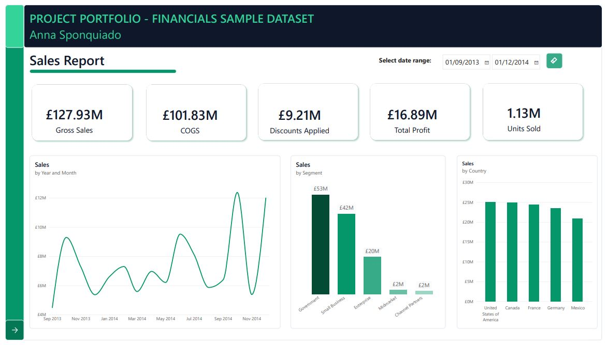

# Power BI Financials Analysis

## Project Overview

I created this two-page Power BI report as part of my training with **DIO (Digital Innovation One)**, using Microsoft's Financials sample dataset.

The aim was to practise importing and preparing data, building interactive visualisations and presenting financial information in a way that is clear and easy to explore.

I wanted to create a report that would allow someone to quickly understand overall business performance, while also being able to look more closely at sales and profitability across different segments, countries and reporting periods.

## Report Preview

## Tools Used

- **Power BI Desktop** – Building and designing the report
- **Power Query** – Checking and preparing the dataset
- **Excel** – Source dataset format
- **GitHub** – Documenting and sharing the project

## The Dataset

I used Microsoft's Financials sample dataset, which contains sales and financial information across different countries, products and business segments.

The main fields include:

- Segment and Country
- Product and Discount Band
- Units Sold
- Manufacturing Price and Sale Price
- Gross Sales and Discounts
- Sales and Cost of Goods Sold (COGS)
- Profit and Date

The dataset covers September 2013 to December 2014.

## Preparing the Data

I started by loading the dataset into Power Query and checking the data before creating any visuals.

This included:

- Reviewing the columns and their data types
- Checking for null values and inconsistencies
- Changing monetary columns to the Fixed Decimal Number data type
- Looking more closely at records showing negative profit

One thing I found interesting during this process was that some transactions had negative profit values.

Rather than assuming these were errors, I checked the financial figures and found that the losses were consistent with the relationship between sales and costs.

I kept these records because they represented valid financial results and could tell us something important about business performance.

## Building the Report

I divided the report into two pages so that sales and profitability could be explored separately without overcrowding the report.

### Page 1 – Sales Report

The first page gives an overview of financial performance through five KPI cards:

| KPI | Value |
|---|---:|
| Gross Sales | £127.93M |
| COGS | £101.83M |
| Discounts | £9.21M |
| Profit | £16.89M |
| Units Sold | 1.13M |

I also included:

- Sales by Year and Month
- Sales by Segment
- Sales by Country
- An interactive date slicer

I used a line chart for monthly sales to make changes over time easier to follow, and column charts to compare sales between segments and countries.

### Page 2 – Profit Report

The second page focuses on profitability and includes:

- Sales and Profit by Segment
- Profit by Year and Month
- Profit by Segment
- Profit by Country
- An interactive year slicer
- A Key Findings section

I particularly wanted to compare sales and profit across business segments, as I was interested in seeing whether the segments generating the most sales were also the most profitable.

This comparison led to the most interesting finding in the project.

## What I Found

### 1. Government leads in sales and profit

Government is the strongest-performing segment in the dataset, generating the highest sales and approximately £11.4M in profit.

### 2. Enterprise has high sales but negative profit

This was the finding that caught my attention the most.

While building the charts, I noticed that Enterprise had generated approximately £20M in sales but recorded a loss of around £0.6M.

I decided to make this more visible in the report because I thought it was important to show that high sales don't necessarily mean high profitability.

It also made me curious about what was driving the loss.

Looking more closely at costs, discounts and individual products would be a useful next step to understand why Enterprise was performing differently from the other segments.

### 3. Sales and profit change considerably over time

The monthly charts show noticeable fluctuations in both sales and profit throughout the reporting period.

It would be interesting to explore whether these changes are linked to particular products, segments or seasonal patterns.

### 4. Different segments contribute differently to profitability

Comparing sales and profit side by side made it easier to see that the relationship between the two isn't the same across all segments.

This reinforced the value of looking at several financial measures together rather than relying on sales figures alone.

## Design Decisions

I wanted the report to be visually consistent, easy to navigate and not too crowded.

Some of the decisions I made included:

- Using a navy, green and mint colour palette throughout the report
- Placing the main KPIs at the top of the Sales page
- Separating sales and profit into two pages
- Using line charts to show monthly trends
- Using column charts to compare business segments and countries
- Adding slicers so users could explore different reporting periods
- Adding navigation between the two pages
- Including a Key Findings section to draw attention to the most interesting results

I also experimented with different ways of presenting the information and made changes as the report developed.

For example, I changed some of the visuals after deciding that other chart types would make comparisons and trends easier to understand.

## Skills Practised

Through this project, I gained more hands-on experience with:

- Importing data into Power BI
- Using Power Query to inspect and prepare data
- Checking data types and identifying unusual values
- Creating and formatting KPI cards
- Building line and column charts
- Working with date fields and slicers
- Creating a multi-page report
- Designing a consistent report layout
- Comparing financial measures across different dimensions
- Identifying and communicating findings from data

## How to View the Report

1. Download `financials_dataset_DIO_project.pbix` from this repository.
2. Open the file in Microsoft Power BI Desktop.
3. Explore the Sales and Profit report pages.
4. Use the slicers to filter the information by reporting period.

## What I Would Explore Next

Although the objective of this project was to build the Power BI report, the results raised some questions that I would be interested in investigating further:

- Why is the Enterprise segment operating at a loss?
- How much are discounts affecting profitability?
- Which products have the strongest and weakest profit margins?
- Are there any recurring patterns in monthly sales and profit?

These would be interesting starting points for a more detailed financial analysis.

## About This Project

This project is part of my transition into data analysis and business intelligence.

I'm developing my technical skills through hands-on projects, with a particular interest in data quality, understanding how information is structured and using data to answer practical business questions.

For me, one of the most enjoyable parts of this project was moving beyond creating the charts and starting to question what the figures were telling me.
